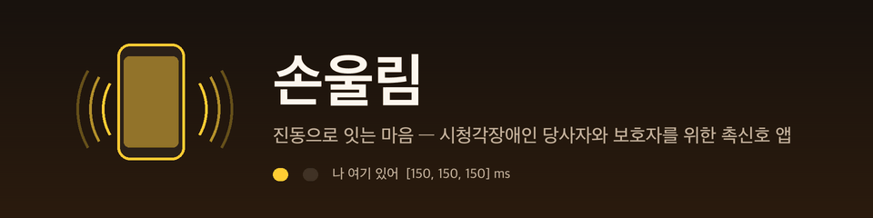
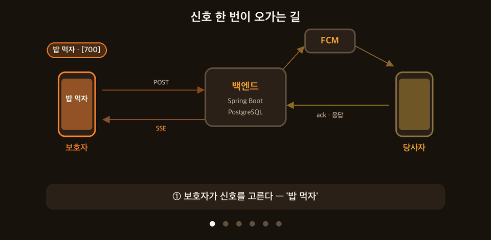
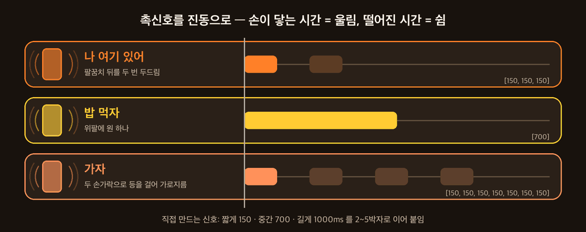
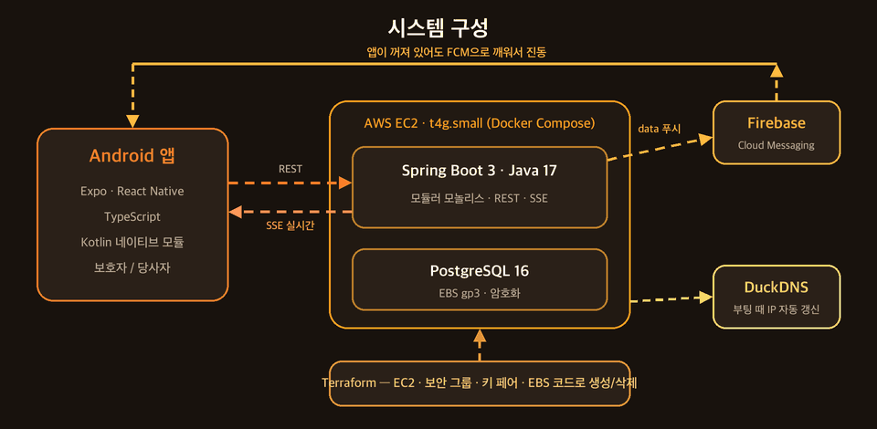

**시청각장애인 당사자와 보호자를 진동 신호로 잇는 안드로이드 앱**

---

## 🤝 손울림

시청각장애인은 **촉신호** — 등이나 팔 위에 손으로 그리는 약속된 동작 — 로 가까운 사람과 짧은 뜻을 주고받아요.
하지만 촉신호는 **손이 닿는 거리**에서만 쓸 수 있어요. 다른 방에 있거나 밖에 나가 있으면 "밥 먹자", "나 여기 있어" 한마디를 전할 방법이 없죠.

손울림은 그 촉신호를 **휴대폰 진동 리듬**으로 옮겨, 떨어져 있어도 같은 뜻을 전하고 화면을 보지 않고도 응답할 수 있게 해요.

## 📳 신호 전송

- 앱이 **꺼져 있어도** FCM data 푸시(Android priority high)로 깨워 잠금화면 위에서 리듬대로 울려요.
- 당사자는 **화면 어디든 터치**해 응답하고, 보호자 화면에는 도착 · 재생 · 응답 상태가 **SSE로 실시간** 바뀌어요.
- 대기 시간 안에 응답이 없으면 보호자에게 '응답 없음'을 알려요.

## 🖐️ 촉신호 >> 진동

손이 **닿아 있는 시간 = 울림**, **떨어진 시간 = 쉼**으로 옮겨 `[울림, 쉼, 울림, …]` ms 배열로 저장해요.
기본 신호 외에도 짧게 · 중간 · 길게를 이어 붙여 우리만의 신호를 만들 수 있어요.

##  주요 기능

<table>
<tr>
<th width="50%">🧡 보호자</th>
<th width="50%">💚 당사자</th>
</tr>
<tr valign="top">
<td>

- **신호 보내기** — 기본 신호 · 직접 만든 신호 · 긴급 신호
- **신호 만들기** — 리듬 프리셋 또는 직접 조합, 미리 느껴 보기
- **알려주기** — 연습 진동을 보내 옆에서 뜻을 알려 주기
- **기록** — 보낸 · 받은 신호와 도착 · 응답 상태, 다시 보내기
- **위치** — 요청한 순간의 위치를 지도로 확인 (경로는 남기지 않음)
- **연결 확인** — 당사자 휴대폰이 신호를 받을 수 있는지 확인

</td>
<td>

- **화면 전체가 하나의 버튼** — 한 번 탭 연결 확인 · 두 번 탭 보호자 부르기 · 3초 길게 도움 요청
- **신호 받기** — 앱이 꺼져 있어도 잠금화면 위로 켜지고 응답할 때까지 반복
- **전원 버튼 3번** — 화면이 꺼진 상태에서도 손울림 실행
- **내 진동 설정** — 세기 · 길이를 직접 느껴 보고 저장
- **TalkBack** 사용자 지정 동작 지원

</td>
</tr>
</table>

##  시스템 구성

| 영역 | 구성 |
|---|---|
| **앱** | Expo · React Native · TypeScript, Kotlin 네이티브 모듈(진동 · 포그라운드 서비스 · 전원 버튼 · 잠금화면 실행 · FCM 수신) |
| **백엔드** | Spring Boot 3 · Java 17 모듈러 모놀리스, PostgreSQL 16, JWT 인증(갱신 토큰 회전), REST + SSE |
| **푸시** | Firebase Cloud Messaging — 저장이 끝난 뒤 data-only 메시지로 발송, 만료된 기기 토큰 자동 정리 |
| **인프라** | Docker Compose, AWS EC2(t4g · arm64) + EBS, Terraform으로 생성 · 삭제, DuckDNS로 부팅 때 주소 갱신 |

##  Repositories

| 레포 | 설명 |
|---|---|
| [**frontend**](https://github.com/hackathon-line4/frontend) | 안드로이드 앱 (Expo · React Native · Kotlin) |
| [**backend**](https://github.com/hackathon-line4/backend) | API 서버 · 실시간 이벤트 · 푸시 · 배포 구성 (Spring Boot · Terraform) |

## 👥 Team

<table>
<tr>
<td align="center" width="16%"><a href="https://github.com/Dayeon0820"> <b>이다연</b></a> Frontend</td>
<td align="center" width="16%"><a href="https://github.com/feseungwon"> <b>feseungwon</b></a> Frontend</td>
<td align="center" width="16%"><a href="https://github.com/YJEND"> <b>최용주</b></a> Backend · Infra 인증 · 설정 · 진동 · 푸시 · 배포</td>
<td align="center" width="16%"><a href="https://github.com/eunsolee"> <b>최은솔</b></a> Backend 계정 연결 · 기록</td>
<td align="center" width="16%"><a href="https://github.com/gksruf22"> <b>조한결</b></a> Backend 신호 전송 · 당사자 · 위치</td>
<td align="center" width="16%"><a href="https://github.com/eunbyul0117"> <b>하은별</b></a> Backend 신호 관리 · 리듬</td>
</tr>
</table>

4호선톤 · 2026

